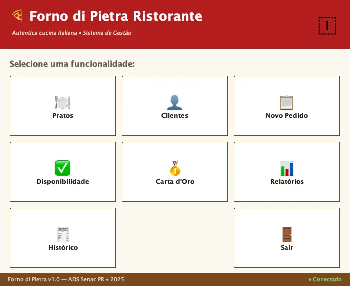
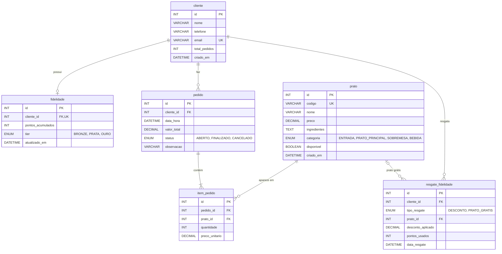
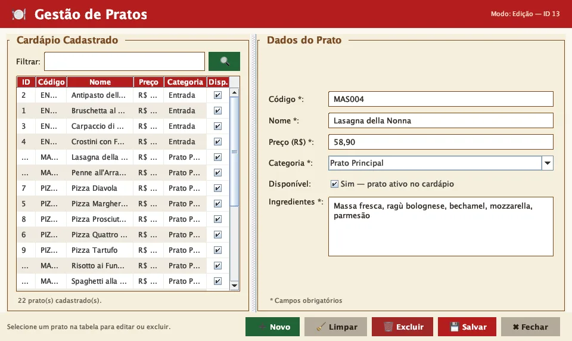
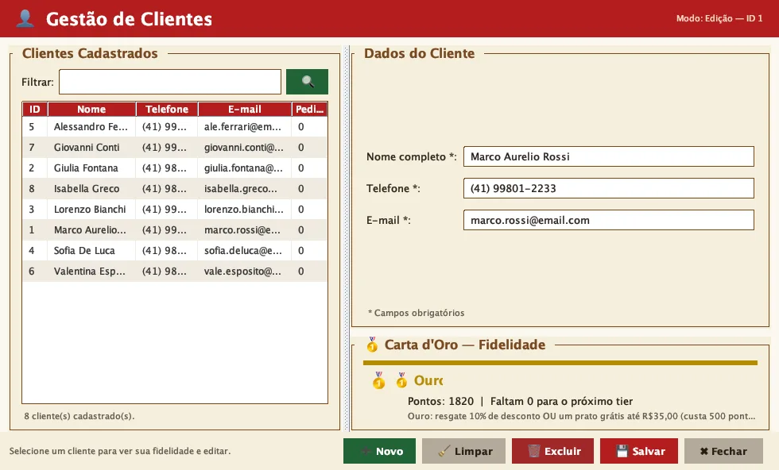
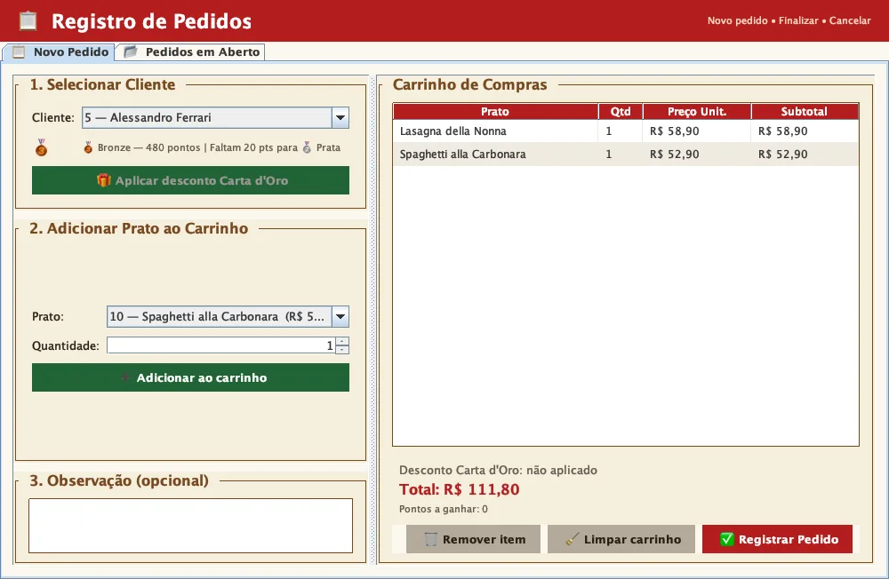
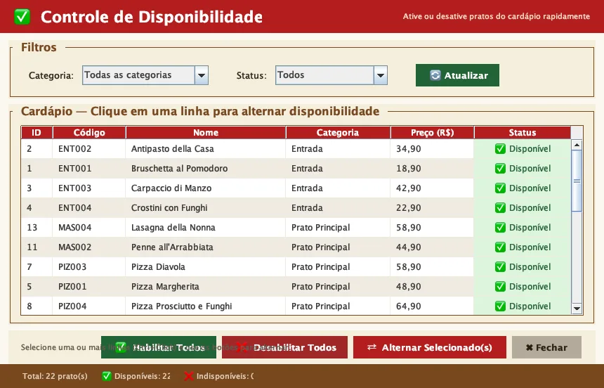
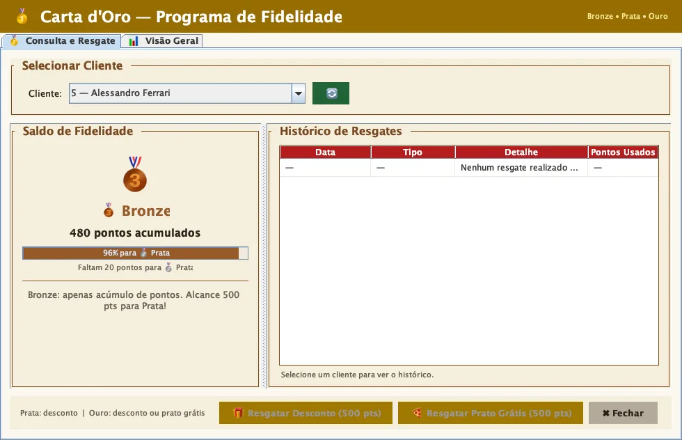
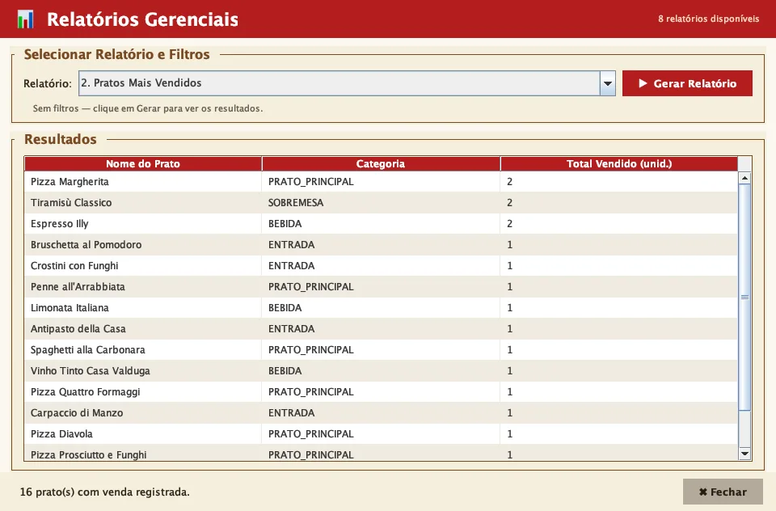

# 🍕 Forno di Pietra Ristorante

> Sistema desktop em Java para gerenciamento completo de restaurante italiano — CRUD de pratos e clientes, registro de pedidos com fatura, controle de disponibilidade e o programa de fidelidade **Carta d'Oro** (Bronze · Prata · Ouro).



---

## 🏛️ Sobre a empresa

**Forno di Pietra Ristorante** é um restaurante italiano especializado em pizzas artesanais assadas em forno a lenha de pedra. Fundado com o propósito de trazer a autenticidade da culinária italiana ao Brasil, o restaurante combina tradição e tecnologia para oferecer a melhor experiência aos seus clientes.

---

## 🚀 Como executar

### Pré-requisitos

| Ferramenta | Versão mínima | Download |
|---|---|---|
| Java JDK | 17 | [adoptium.net](https://adoptium.net) |
| Apache Maven | 3.9 | [maven.apache.org](https://maven.apache.org) |
| Docker Desktop | qualquer | [docker.com](https://www.docker.com/products/docker-desktop) |

### Passo 1 — Clone o repositório

```bash
git clone https://github.com/PeSzpak/Forno-di-Pietra-Ristorante.git
cd Forno-di-Pietra-Ristorante
```

### Passo 2 — Suba o banco de dados

```bash
docker-compose up -d
```

> Aguarde ~15 segundos. O MySQL inicializa, cria o banco `fornodipietra` e popula com dados de exemplo automaticamente via `sql/init.sql`.

**Verificar se subiu corretamente:**
```bash
docker ps
# Deve mostrar: fornodipietra-db e fornodipietra-admin em status "healthy"
```

**phpMyAdmin** disponível em: [http://localhost:8080](http://localhost:8080)
- Usuário: `forno` | Senha: `forno123`

### Passo 3 — Crie o `db.properties`

O arquivo `src/main/resources/db.properties` está no `.gitignore` e não vem no clone. Sem ele, o sistema para com "Arquivo db.properties não encontrado em resources/". Crie-o com as credenciais do `docker-compose.yml`:

```bash
mkdir -p src/main/resources
cat > src/main/resources/db.properties <<'PROPS'
db.url=jdbc:mysql://localhost:3306/fornodipietra?useSSL=false&allowPublicKeyRetrieval=true&serverTimezone=America/Sao_Paulo
db.user=forno
db.password=forno123
PROPS
```

| Chave | Uso |
|---|---|
| `db.url` | URL JDBC do MySQL (porta 3306 do container) |
| `db.user` / `db.password` | Usuário criado pelo `docker-compose.yml` |

### Passo 4 — Compile e execute

```bash
mvn clean package -q
java -jar target/forno-di-pietra.jar
```

Ou no IntelliJ IDEA: abra o projeto → clique em `Main.java` → **Run**.

Sem Maven, dá para compilar só com o JDK e o driver [mysql-connector-j 8.3.0](https://repo1.maven.org/maven2/com/mysql/mysql-connector-j/8.3.0/mysql-connector-j-8.3.0.jar):

```bash
javac -encoding UTF-8 -d out $(find src/main/java -name '*.java')
java -cp "out:src/main/resources:mysql-connector-j-8.3.0.jar" com.fornodipietra.Main
```

### Passo 5 — Encerrar

```bash
docker-compose down          # Para e remove os containers (dados preservados)
docker-compose down -v       # Para, remove containers E dados do banco
```

---

## 🗂️ Estrutura do projeto

```
forno-di-pietra/
│
├── docker-compose.yml              # MySQL 8 (porta 3306) + phpMyAdmin (porta 8080)
├── pom.xml                         # Maven: Java 17, mysql-connector 8.3, JUnit 5
├── sql/
│   └── init.sql                    # Schema completo + 22 pratos + 8 clientes
│
└── src/main/java/com/fornodipietra/
    ├── Main.java                   # Ponto de entrada — testa conexão, abre UI
    │
    ├── config/
    │   └── DatabaseConnection.java # Singleton thread-safe, lê db.properties
    │
    ├── model/                      # 6 entidades + 4 ENUMs
    │   ├── Prato.java
    │   ├── Cliente.java
    │   ├── Pedido.java
    │   ├── ItemPedido.java
    │   ├── Fidelidade.java
    │   ├── ResgatesFidelidade.java
    │   ├── CategoriaPrato.java     # ENUM: ENTRADA, PRATO_PRINCIPAL, SOBREMESA, BEBIDA
    │   ├── StatusPedido.java       # ENUM: ABERTO, FINALIZADO, CANCELADO
    │   ├── TierFidelidade.java     # ENUM: BRONZE, PRATA, OURO
    │   └── TipoResgate.java        # ENUM: DESCONTO, PRATO_GRATIS
    │
    ├── dao/                        # SQL puro — sem ORM
    │   ├── PratoDAO.java
    │   ├── ClienteDAO.java
    │   ├── PedidoDAO.java          # Transação commit/rollback na inserção
    │   └── FidelidadeDAO.java
    │
    ├── service/                    # Regras de negócio e validações
    │   ├── PratoService.java
    │   ├── ClienteService.java
    │   ├── PedidoService.java      # Acúmulo de pontos ao finalizar
    │   └── FidelidadeService.java  # Resgates Carta d'Oro
    │
    ├── util/
    │   ├── Validador.java          # 14 métodos — cobre todo o Apêndice II
    │   └── TierUtil.java           # Cálculo de pontos e elegibilidade de resgates
    │
    └── ui/                         # Swing — 7 telas + 2 helpers
        ├── AppColors.java          # Paleta italiana centralizada
        ├── UIHelper.java           # Fábrica de componentes padronizados
        ├── MainFrame.java          # Painel central de navegação
        ├── PratoFormFrame.java     # CRUD completo de pratos
        ├── ClienteFormFrame.java   # CRUD de clientes + painel Carta d'Oro
        ├── PedidoFrame.java        # Novo pedido + fatura + pedidos em aberto
        ├── FidelidadeFrame.java    # Consulta tier, histórico, resgates
        ├── RelatorioFrame.java     # 8 relatórios com filtros dinâmicos
        └── DisponibilidadeFrame.java # Toggle de disponibilidade com filtros
```

---

## 🗄️ Banco de dados

### 6 tabelas

```
prato               — cardápio do restaurante
cliente             — clientes cadastrados
pedido              — pedidos realizados
item_pedido         — itens de cada pedido (N:N entre pedido e prato)
fidelidade          — saldo Carta d'Oro por cliente (1:1)
resgate_fidelidade  — histórico de resgates (desconto ou prato grátis)
```

### Diagrama de relacionamentos

Gerado a partir de `sql/init.sql`:



Regras de exclusão: apagar um pedido apaga seus itens (`CASCADE`); apagar um cliente apaga a fidelidade, mas é bloqueado se houver pedidos ou resgates (`RESTRICT`); um prato usado em pedidos não pode ser apagado, e se sair do cardápio o resgate fica com `prato_id = NULL`.

### Dados de exemplo incluídos

- **22 pratos** italianos reais — entradas, pizzas, massas, sobremesas, bebidas
- **8 clientes** com nomes italianos
- **8 pedidos** de exemplo (finalizados e cancelados)
- **Fidelidade** distribuída: Bronze, Prata e Ouro
- **3 resgates** de exemplo

---

## 🖥️ Funcionalidades

Capturas do sistema rodando localmente com os dados de exemplo do `init.sql` (todos fictícios).

| Pratos | Clientes |
|---|---|
|  |  |
| **Novo pedido** | **Disponibilidade** |
|  |  |
| **Carta d'Oro** | **Relatórios** |
|  |  |

### CRUD

| Tela | Funcionalidades |
|---|---|
| **Pratos** | Cadastrar, editar, excluir (com proteção referencial), filtrar, buscar |
| **Clientes** | Cadastrar, editar, excluir, visualizar tier Carta d'Oro ao selecionar |

### Operações

| Tela | Funcionalidades |
|---|---|
| **Pedidos** | Montar carrinho, aplicar desconto fidelidade, registrar, gerar fatura, finalizar, cancelar |
| **Disponibilidade** | Toggle individual ou em massa, filtros por categoria e status |
| **Carta d'Oro** | Consultar tier, ver progresso com barra, histórico de resgates, resgatar desconto ou prato |

### Relatórios (8 no total)

| # | Relatório | Filtros |
|---|---|---|
| 1 | Pratos por Categoria | — |
| 2 | Pratos Mais Vendidos | — |
| 3 | Clientes Mais Ativos | — |
| 4 | Pedidos de um Cliente | Cliente |
| 5 | Faturamento por Período | Data início/fim |
| 6 | Pratos Indisponíveis | — |
| 7 | Clientes por Tier | — |
| 8 | Resgates de Fidelidade | Data início/fim |

---

## 🥇 Programa de Fidelidade — Carta d'Oro

| Tier | Pontos | Benefício |
|---|---|---|
| 🥉 Bronze | 0 – 499 | Acúmulo de pontos (R$1 = 1 ponto) |
| 🥈 Prata | 500 – 1.499 | Resgate: 5% de desconto (custa 500 pts) |
| 🥇 Ouro | 1.500+ | Resgate: 10% de desconto **ou** prato grátis até R$35 (custa 500 pts) |

**Fluxo automático:**
1. Cliente faz pedido → pontos acumulados ao finalizar
2. Tier recalculado automaticamente após cada operação
3. Resgate desconta 500 pontos e atualiza o tier se necessário

---

## 🛠️ Stack técnica

| Camada | Tecnologia | Versão |
|---|---|---|
| Linguagem | Java | 17 |
| Interface | Java Swing | — |
| Banco | MySQL | 8.0 |
| JDBC Driver | mysql-connector-j | 8.3.0 |
| Build | Apache Maven | 3.9+ |
| Containers | Docker + Docker Compose | — |
| Admin DB | phpMyAdmin | 5.2 |
| Testes | JUnit Jupiter | 5.10.1 |

---

## 📐 Padrão de arquitetura

```
UI (Swing)
    ↓ chama
Service (regras de negócio + Validador + TierUtil)
    ↓ chama
DAO (SQL puro via JDBC)
    ↓ acessa
MySQL (via Docker)
```

**Princípios aplicados:**
- Uma classe por arquivo — sem classes aninhadas em arquivos separados
- `Main.java` como ponto de entrada puro
- Singleton para conexão com o banco (`DatabaseConnection`)
- Transação explícita no `PedidoDAO` — commit/rollback
- Validações centralizadas no `Validador` e `TierUtil`
- Sem ORM, sem frameworks externos — JDBC direto

---

## ✅ Regras de validação implementadas (Apêndice II)

| Seção | Regra | Onde |
|---|---|---|
| 2.1 | Nome mín. 3 chars, não só números, trim() | `Validador.validarNome()` |
| 2.2 | Descrições máx. 500 chars, não só espaços | `Validador.validarDescricaoObrigatoria()` |
| 3 | Datas no formato dd/MM/yyyy, intervalo válido | `Validador.validarData/IntervaloData()` |
| 4.2 | Fluxo ABERTO→FINALIZADO/CANCELADO | `Validador.validarFinalizar/CancelarPedido()` |
| 4.3 | Prato indisponível não entra no pedido | `PedidoService.registrar()` |
| 5 | Confirmação e motivo antes de cancelar | Todas as telas com `UIHelper.confirmarDialog()` |
| 6 | Não excluir cliente/prato com pedidos vinculados | `ClienteService/PratoService.excluir()` |
| 7 | Data inicial ≤ data final nos relatórios | `Validador.validarIntervaloData()` |
| 7 | "Nenhum registro encontrado..." quando vazio | `RelatorioFrame.semResultados()` |
| 8 | Botão Salvar com validação antes de persistir | Todos os FormFrames |
| 8 | Mensagens claras via JOptionPane | `UIHelper.erroDialog/avisoDialog()` |

---

## 🔢 Métricas do projeto

| Métrica | Valor |
|---|---|
| Arquivos Java | 32 |
| Linhas de código | ~6.950 |
| Telas Swing | 7 |
| Relatórios | 8 |
| Tabelas no banco | 6 |
| Regras de validação | 14 métodos |
| Commits | 15 |

---

## 🧪 Testes

`src/test/java/com/fornodipietra/DatabaseConnectionTest.java` tem dois testes (Singleton e obtenção de conexão). Rode com `mvn test`, com o banco no ar e o `db.properties` criado: sem o arquivo, `getInstance()` lança exceção e o primeiro teste falha.

---

## ⚠️ Limitações conhecidas

- **Acentos corrompidos no banco criado pelo Docker.** O `init.sql` não define `SET NAMES utf8mb4`, e o cliente `mysql` que o container usa para rodar o script assume `latin1`. Resultado: "Tiramisù" vira "Tiramisù", "ragù" vira "ragù" etc. Para corrigir um banco já criado, recarregue o script forçando UTF-8:
  ```bash
  docker exec -i fornodipietra-db sh -c "mysql -uroot -proot -e 'DROP DATABASE fornodipietra' && mysql -uroot -proot --default-character-set=utf8mb4" < sql/init.sql
  ```
  A correção definitiva é adicionar `SET NAMES utf8mb4;` no topo do `init.sql` e recriar o volume (`docker-compose down -v`).
- `cliente.total_pedidos` é semeado com `0` para todos, mesmo para quem já tem pedidos no `init.sql`; a coluna "Pedidos" da tela de clientes começa inconsistente.
- O `db.properties` não tem arquivo de exemplo versionado (ver Passo 3).

---

## 👥 Equipe

> Projeto desenvolvido para a disciplina de **Análise e Desenvolvimento de Sistemas**
> Faculdade de Tecnologia Senac PR — 3º Período — 2025
>
> Equipe: Pedro Szpak, Ademir Jnr. e Christian Ferreira

---

## 📄 Referências

- BARNES, David J. *Programação orientada a objetos com Java*. Pearson, 2009.
- DEITEL, Paul J.; DEITEL, Harvey M. *Java: como programar*. 8. ed. Pearson, 2010.
- SILBERSCHATZ, Abraham et al. *Sistema de banco de dados*. 7. ed. Elsevier, 2020.
- PRESSMAN, Roger S. *Engenharia de software*. 8. ed. McGrawHill, 2016.
